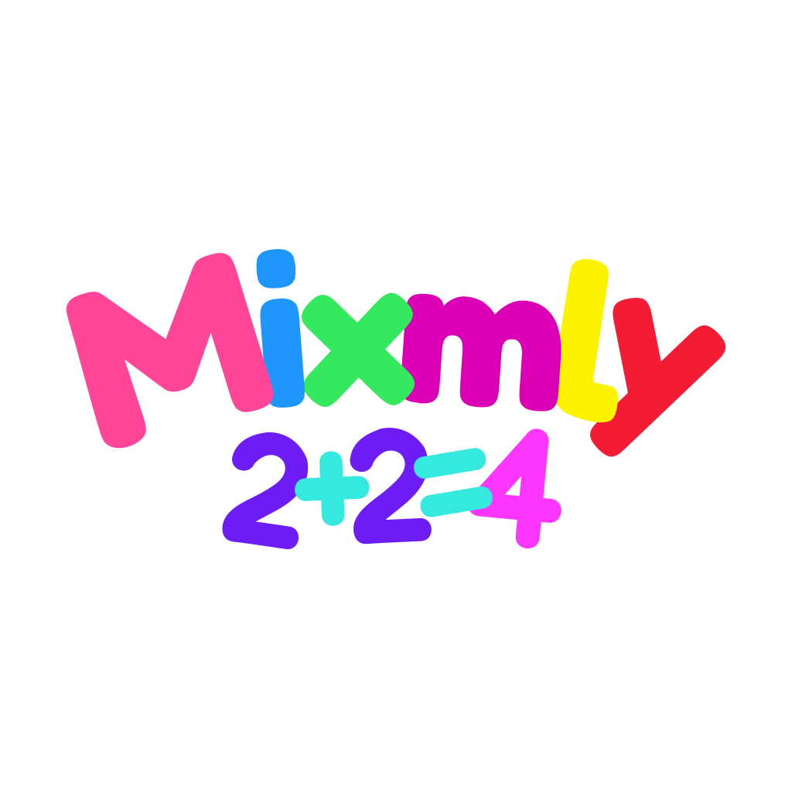

# Mixmly

<p align="center">
  
</p>

**Mixmly** is a math game where players build correct arithmetic examples from
moving tokens. The game is designed to make mental math feel active, playful,
and visual.

In Mixmly, numbers and math symbols appear as physical objects on the screen.
The player selects and arranges them to make a correct equation. When the
equation is correct, the tokens break into pieces and the example is marked as
completed.

## Overview

Mixmly is a fast and simple arithmetic training game. It helps players practice
basic math operations:

- Addition
- Subtraction
- Multiplication
- Division

The game uses a physics-based play field. Tokens can fall, move, collide, and
react to clicks. This makes the game feel more like a puzzle toy than a normal
worksheet.

## Gameplay

The player sees many tokens on the screen. A token can be:

- A number, such as `3`, `10`, or `25`
- A math operation, such as `+`, `-`, `*`, or `/`
- An equals sign, `=`

The goal is to select tokens that form a correct math example.

Examples of valid equations:

```text
3 + 4 = 7
10 - 6 = 4
5 * 2 = 10
12 / 3 = 4
```

The equation can also be written with the answer on the left:

```text
7 = 3 + 4
4 = 10 - 6
10 = 5 * 2
4 = 12 / 3
```

## Rules

A completed example must follow these rules:

1. It must contain two numbers, one operation, an equals sign, and one result.
2. It must be mathematically correct.
3. The order of selected tokens is read from left to right.
4. The game accepts examples in these formats:

```text
number operation number = number
number = number operation number
```

5. Incorrect examples are not completed.
6. When an example is correct, it is removed from the play field and saved as
   completed.

## Exercise Settings

Players can change the exercise settings.

The settings include:

- Minimum number
- Maximum number
- Math operations
- Number of examples
- Addition result limit

The game can generate from 1 to 50 examples. Numbers can be selected from a
range between 0 and 100.

## Operations

### Addition

Addition examples use the `+` symbol.

Example:

```text
2 + 5 = 7
```

There is also an option to keep addition results inside the selected number
range.

### Subtraction

Subtraction examples use the `-` symbol.

Example:

```text
9 - 4 = 5
```

The game avoids negative answers when generating subtraction examples.

### Multiplication

Multiplication examples use the `*` symbol.

Example:

```text
6 * 3 = 18
```

### Division

Division examples use the `/` symbol.

Example:

```text
12 / 4 = 3
```

The game generates division examples that have whole-number answers. It avoids
division by zero.

## Completed Examples

When the player solves an example, it is added to the completed examples list.

The player can open this list to review solved examples. A completed example
can also be restored back to the play field.

## Visual Style

Mixmly uses large, colorful number tokens. The tokens are drawn as shapes and
behave like objects in a physics simulation.

When a correct example is solved, the selected tokens break apart into small
pieces. This gives the player immediate visual feedback.

## App Features

Mixmly includes:

- Physics-based token movement
- Custom exercise generation
- Completed examples list
- Light, dark, and system theme modes
- Installable Progressive Web App support
- Saved game state between sessions

## Purpose

The main purpose of Mixmly is to make arithmetic practice more fun. Instead of
only writing answers, players interact with numbers directly. This can help make
basic math practice feel more engaging and less repetitive.

## Development

### Scripts

- `npm run dev` starts the Vite development server.
- `npm start` starts the Vite development server.
- `npm run build` runs type checks and creates a production build.
- `npm run preview` serves the production build locally.
- `npm run lint` runs ESLint with the current flat config.
- `npm run format` formats the project with Prettier.
- `npm run format:check` verifies formatting without writing changes.
- `npm run typecheck` runs TypeScript checks without emitting files.

### Structure

- `src/components` contains UI components.
- `src/pwa` contains PWA-specific runtime helpers and types.
- `src/env.ts` contains typed access to Vite environment variables.
- `src/main.css` contains the main Tailwind-powered stylesheet.

[](https://hits.sh/github.com/oleksiy-nesterov/mixmly/)
